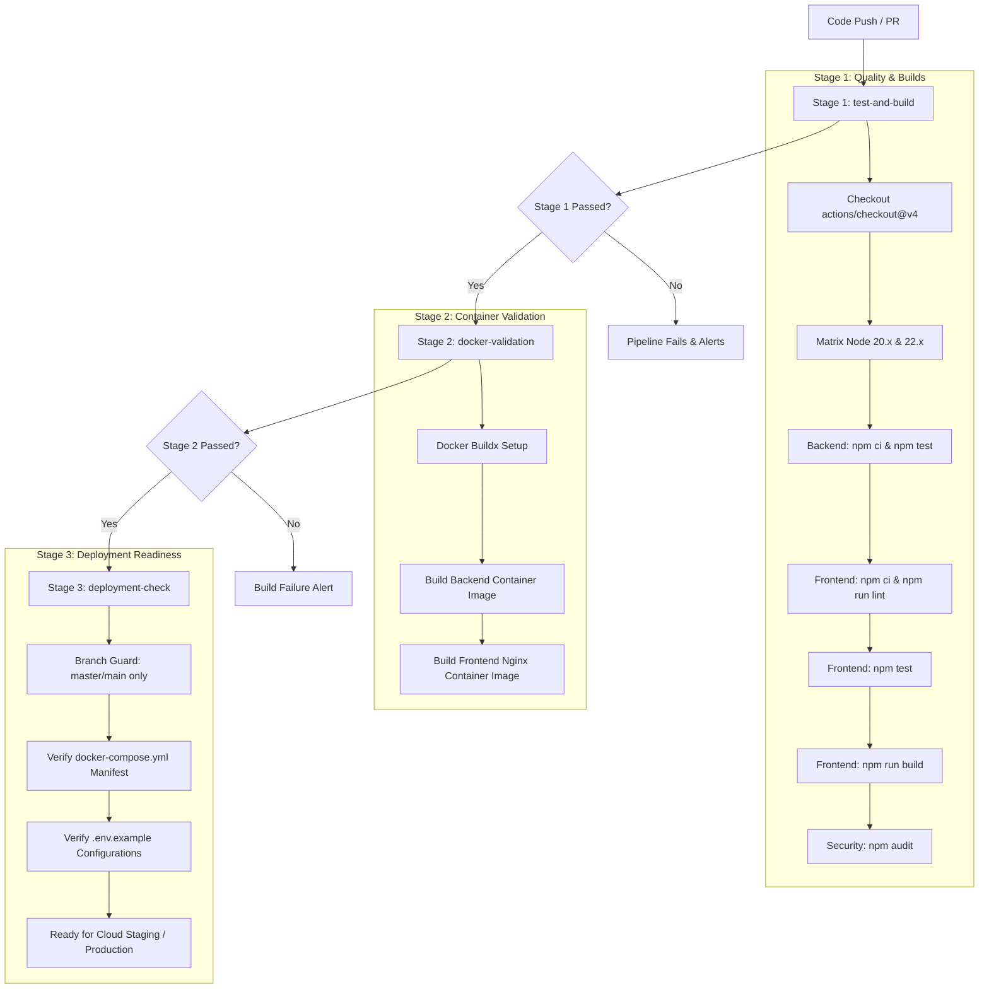

# 02 - CI/CD Pipeline Configuration Specification

## 1. Pipeline Overview
**Platform:** GitHub Actions  
**Workflow File:** `.github/workflows/ci.yml`  
**Trigger Events:** 
- `push` to `master` and `main` branches
- `pull_request` to `master` and `main` branches

The Continuous Integration and Continuous Deployment (CI/CD) pipeline for CalliLab is architected into **three distinct, sequential stages** to ensure rigorous verification before any code reaches production.

---

## 2. Pipeline Architecture & Execution Stages

---

## 3. Detailed Stage Breakdown

### Stage 1: Code Quality, Tests & Builds (`test-and-build`)
- **Runner Environment:** `ubuntu-latest`
- **Matrix Strategy:** Tested concurrently across **Node.js 20.x** (Active LTS) and **Node.js 22.x** (Current LTS) to guarantee backward and forward compatibility.
- **Dependency Caching:** Utilizes `actions/setup-node@v4` with `cache: 'npm'` referencing `backend/package-lock.json` and `frontend/package-lock.json` to accelerate execution.
- **Steps Executed:**
  1. `actions/checkout@v4`: Retrieves repository tree.
  2. `actions/setup-node@v4`: Installs requested Node runtime and restores npm package caches.
  3. `backend npm ci`: Clean installation of deterministic backend dependencies.
  4. `backend npm test`: Executes 7 automated tests covering CalliVision v2.4 multi-metric calculation and Express controller exports.
  5. `frontend npm ci`: Clean installation of frontend dependencies.
  6. `frontend npm run lint`: Runs ESLint with custom rule overrides (`rules-of-hooks: error`, `exhaustive-deps: warn`).
  7. `frontend npm test`: Executes 4 automated unit tests validating SkillRadar geometric coordinates.
  8. `frontend npm run build`: Compiles production bundle with Vite 8.
  9. `npm audit`: Scans both backend and frontend for critical dependency vulnerabilities.

### Stage 2: Container Build & Validation (`docker-validation`)
- **Dependency:** Runs only if `test-and-build` succeeds (`needs: test-and-build`).
- **Runner Environment:** `ubuntu-latest`
- **Steps Executed:**
  1. `docker/setup-buildx-action@v3`: Configures Docker Buildx engine.
  2. `docker/build-push-action@v6` (Backend): Tests building the backend Docker image using `backend/Dockerfile` with `push: false` to validate Dockerfile syntax and layer caching without pushing images.
  3. `docker/build-push-action@v6` (Frontend): Tests building the multi-stage frontend Docker image (Node builder -> Nginx runtime) using `frontend/Dockerfile` with `push: false`.

### Stage 3: Deployment Readiness Verification (`deployment-check`)
- **Dependency:** Runs only after `docker-validation` succeeds (`needs: docker-validation`).
- **Conditional Execution:** Evaluated exclusively on `master` and `main` branches (`if: github.ref == 'refs/heads/master' || github.ref == 'refs/heads/main'`).
- **Steps Executed:**
  1. Audits availability of `docker-compose.yml` multi-container specification.
  2. Verifies integrity of sanitized configuration template `backend/.env.example`.
  3. Confirms readiness for automated deployment onto cloud container environments.

---

## 4. Security and Secrets Management in the Pipeline
- **Principle of Least Privilege:** Top-level permissions are strictly declared as `permissions: { contents: read }`.
- **Zero Secrets Exposure:** No hardcoded tokens, passwords, or API keys are embedded in `.github/workflows/ci.yml`.
- **Environment Parity:** Production secrets (`JWT_SECRET`, `MONGO_URI`, Cloudinary credentials) are intended to be supplied via **GitHub Repository Secrets** (`${{ secrets.MONGO_URI }}`) during the actual remote deployment step.
