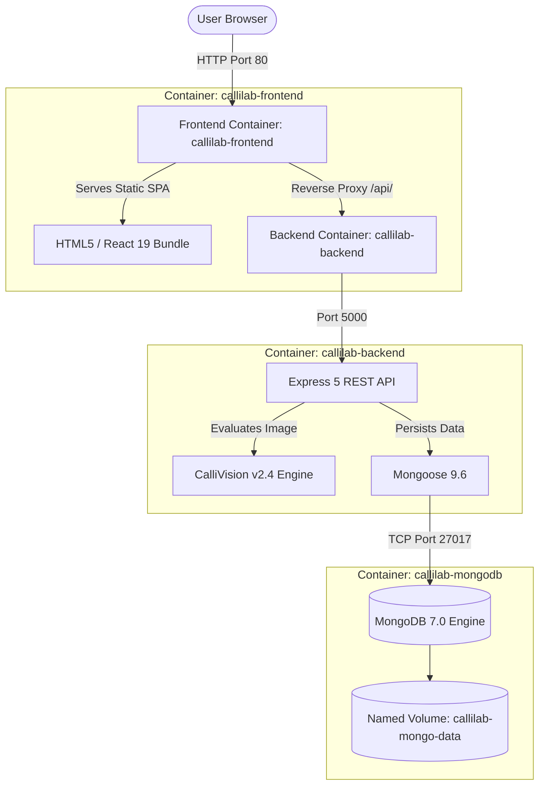

# 04 - Docker Containerization and Compose Validation

## 1. Containerization Architecture
CalliLab implements an enterprise-standard container topology separating stateless application tiers from persistent storage.



---

## 2. Docker Artifact Specifications

### 2.1 Backend Container (`backend/Dockerfile`)
- **Base Image:** `node:22-alpine` (lightweight, minimal attack surface).
- **Security Hardening:** Creates non-privileged user `node` and drops root permissions (`USER node`).
- **Optimization:** Copies `package*.json` independently before source code to maximize Docker build layer caching.
- **Healthcheck:** Configures native health check:
  ```dockerfile
  HEALTHCHECK --interval=30s --timeout=5s --start-period=10s --retries=3 \
    CMD curl -f http://localhost:5000/api/health || exit 1
  ```

### 2.2 Frontend Container (`frontend/Dockerfile`)
- **Multi-Stage Build Pattern:**
  - **Stage 1 (Builder):** `node:22-alpine` compiles the Vite single-page application into `/app/dist`.
  - **Stage 2 (Runtime):** `nginx:1.27-alpine` receives solely the minified static assets (`/usr/share/nginx/html`).
- **Nginx Configuration (`frontend/nginx.conf`):**
  - Configures `try_files $uri $uri/ /index.html;` for seamless client-side React Router navigation.
  - Implements Gzip compression on CSS, JS, SVG, and JSON.
  - Reverse proxies `/api/` traffic directly to the internal Docker service `http://backend:5000/api/`.

### 2.3 Docker Compose Multi-Container Configuration (`docker-compose.yml`)
- Orchestrates three interrelated services:
  1. `mongodb`: MongoDB 7.0 with persistent storage volume `callilab-mongo-data`.
  2. `backend`: Express API with dependency wait condition (`condition: service_healthy` on MongoDB).
  3. `frontend`: Nginx web server exposing port `80:80`.
- All services communicate over an isolated bridge network: `callilab-network`.

---

## 3. Local Docker Configuration Validation Results
**Command Executed:** `docker compose config`  
**Execution Context:** `c:\Users\Lakshitha SM\Desktop\CalliVerse`  
**Exit Code:** `0` (Validation Successful)

```yaml
name: calliverse
services:
  backend:
    build:
      context: c:\Users\Lakshitha SM\Desktop\CalliVerse\backend
      dockerfile: Dockerfile
    container_name: callilab-backend
    depends_on:
      mongodb:
        condition: service_healthy
        required: true
    environment:
      CLIENT_URL: http://localhost:80
      JWT_SECRET: calliverse_production_secret_key_change_in_env
      MONGO_URI: mongodb://mongodb:27017/calliverse
      NODE_ENV: production
      PORT: "5000"
    networks:
      callilab-network: null
    ports:
      - mode: ingress
        target: 5000
        published: "5000"
        protocol: tcp
    restart: unless-stopped
    volumes:
      - type: volume
        source: backend-uploads
        target: /usr/src/app/uploads
        volume: {}
  frontend:
    build:
      context: c:\Users\Lakshitha SM\Desktop\CalliVerse\frontend
      dockerfile: Dockerfile
    container_name: callilab-frontend
    depends_on:
      backend:
        condition: service_started
        required: true
    networks:
      callilab-network: null
    ports:
      - mode: ingress
        target: 80
        published: "80"
        protocol: tcp
    restart: unless-stopped
  mongodb:
    container_name: callilab-mongodb
    healthcheck:
      test:
        - CMD
        - mongosh
        - --eval
        - db.adminCommand('ping')
      timeout: 5s
      interval: 15s
      retries: 5
      start_period: 10s
    image: mongo:7.0
    networks:
      callilab-network: null
    ports:
      - mode: ingress
        target: 27017
        published: "27017"
        protocol: tcp
    restart: unless-stopped
    volumes:
      - type: volume
        source: mongo-data
        target: /data/db
        volume: {}
networks:
  callilab-network:
    name: callilab-network
    driver: bridge
volumes:
  backend-uploads:
    name: callilab-backend-uploads
  mongo-data:
    name: callilab-mongo-data
```

---

## 4. Local Execution Instructions
*Note: Docker Desktop v28.1.1 is installed on the local system. To build and start the containers locally:*

1. Launch **Docker Desktop** from the Windows Start menu or Desktop shortcut (`C:\Program Files\Docker\Docker\Docker Desktop.exe`).
2. Run in terminal:
   ```powershell
   docker compose up --build -d
   ```
3. Verify running containers:
   ```powershell
   docker compose ps
   ```
4. Access CalliLab via browser at: **`http://localhost:80`**.
