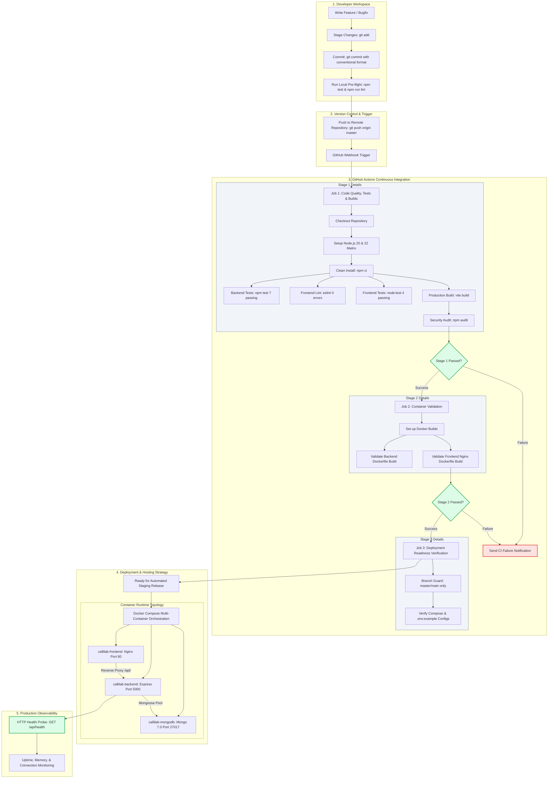

# 07 - End-to-End DevOps Lifecycle and Pipeline Architecture

This document diagrams the complete DevOps lifecycle implemented for CalliLab, from developer commit to automated validation, container packaging, and production operations.

---

## 1. End-to-End DevOps Lifecycle Flowchart

---

## 2. Stage-by-Stage Verification Gate Matrix

| Phase | Tool / Action | Quality Gate | Action on Failure |
| :--- | :--- | :--- | :--- |
| **Local Check** | `npm test` | 100% test pass rate (7 BE + 4 FE) | Block commit |
| **Static Analysis** | `npm run lint` | 0 fatal errors, rules-of-hooks valid | Block PR merge |
| **Compilation** | `vite build` | Zero bundle syntax errors, gzip < 300KB | Block CI build |
| **Container Build** | `docker buildx` | Successful multi-stage Docker build | Reject release |
| **Runtime Health** | `/api/health` | Status code 200, status `healthy` | Trigger orchestrator restart |
